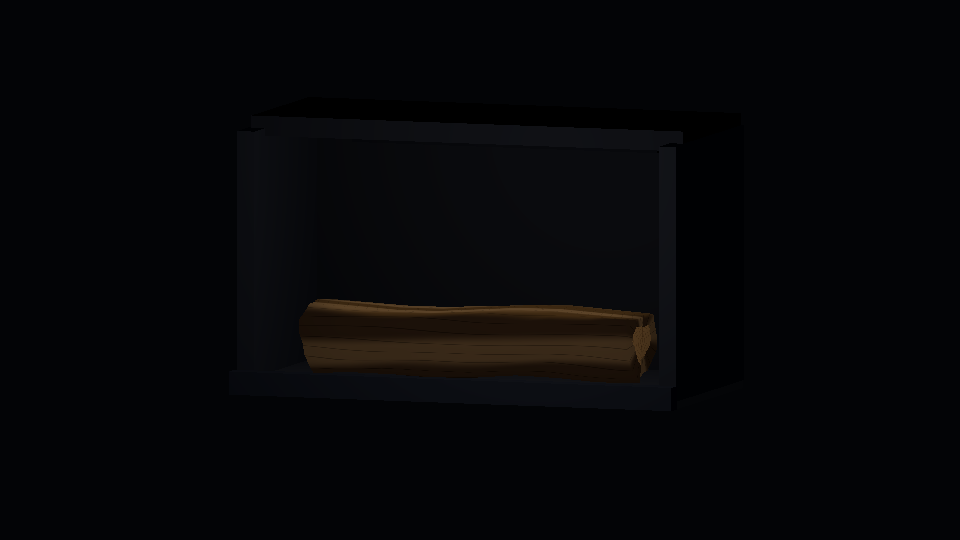
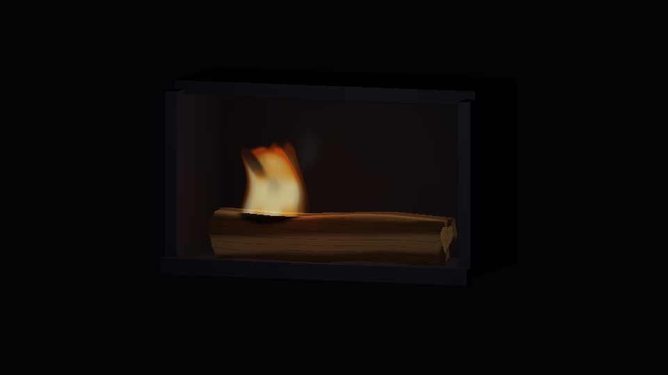
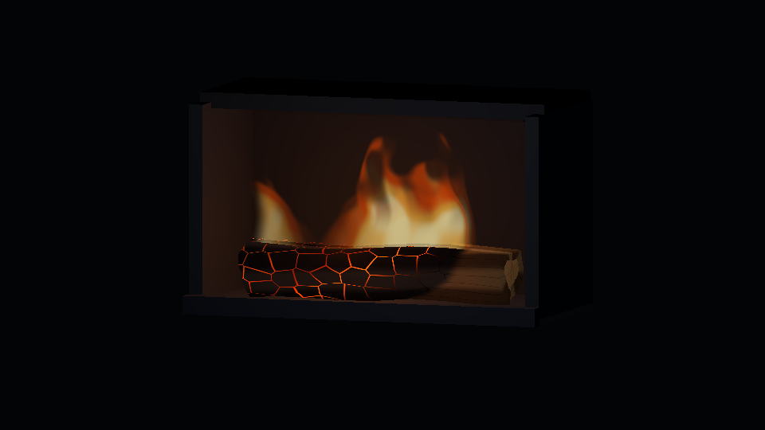
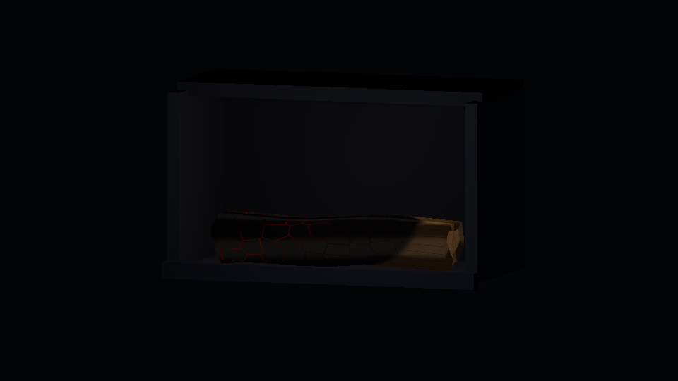

# Одно полено в открытой топке — изолированная визуальная проба

Эксперимент в `codex`, без подключения к production-сценам Hoarbound. Самостоятельный проект: [log_cycle/source](log_cycle/source). Неровное расколотое полено, простая тёмная металлическая топка, неподвижная камера. Вся модель, материалы и эффект созданы для этой пробы; чужие изображения и текстуры в проект не включены.

## Реальные референсы и наблюдения

Просмотрены три фотографии одной открытой топки из [Wood Heat: Too much charcoal?](https://www.woodheat.org/charcoal.html):

- [Полено начинает гореть](https://www.woodheat.org/images/stories/Tips/TooMuchCharcoal/Img4-onelogplaced.jpg): широкая светлая расколотая грань, волокнистый край, локальные языки снизу. Взяты неоднородный силуэт и сохранение светлой древесины вдали от фронта.
- [Активное горение](https://www.woodheat.org/images/stories/Tips/TooMuchCharcoal/Img5-onelogflaming.jpg): тёмная древесина под несимметричными жёлтыми и оранжевыми складками пламени; свет на стенках. Взяты разная высота складок, светлые тёплые ядра и более прозрачные края, без ряда одинаковых красных треугольников.
- [Оставшиеся угли](https://www.woodheat.org/images/stories/Tips/TooMuchCharcoal/Img6-onelogburnt.jpg): неодинаково яркие участки углей при отсутствии высокого пламени. Взята задержка затухания свечения относительно огня. Полного разрушения полена в золу наша проба не изображает.

На фотографиях есть существующая угольная подложка; в пробе её не копируем и оставляем ровно одно полено. Цвета адаптированы к painterly-контракту Hoarbound, без фотографии как текстуры.

[Wood Heat: стадии горения древесины](https://www.woodheat.org/what-space-heater/15-technical/wood-heat-wisdom/58-how-to-build-and-maintain-a-wood-fire.html): нагрев/испарение воды, выделение и горение летучих веществ, тление угля. Стадии перекрываются. Из этого взяты локальный старт, отдельные временные огибающие огня и углей и отсутствие густого дыма на угольной стадии. Тонкий дым при розжиге — художественная интерпретация, а не измеренная реконструкция потока. Он исчезает до устойчивого горения и направлен вверх к горловине.

[Contura: инструкция и видео розжига](https://www.contura.eu/en-gb/guides-and-facts/how-to-light-properly/how-to-light-your-stove) — дополнительная ссылка. Встроенное видео недоступно инструменту просмотра; не использовано как просмотренный видеореференс.

## Кадры и видео

Настоящий графический запуск Godot 4.8-dev6 Mono под Xvfb, без `--headless`. MP4 получен только кодированием PNG из `--write-movie`.

- [Полный цикл, MP4 — 10 секунд](log_cycle/full-cycle.mp4?raw=true).
- [Страница файла MP4](log_cycle/full-cycle.mp4).

### До розжига — progress=0

### Локальный розжиг — progress≈0.151

### Устойчивое горение — progress≈0.502

### Остывающие угли — progress≈0.903

## Реализация и проверка

- Геометрия одного полена: неровные сечения, плоская расколотая грань, слегка неодинаковые торцы. Кора и торцевые кольца заданы крупными поверхностными формами, без фотошума и глянца.
- Общая `arrival_at` задаёт фронт для древесины и пламени. За фронтом остаётся тёмный материал с редкими нерегулярными угольными трещинами. Угольная эмиссия пространственно неодинакова.
- Две широкие прозрачные области пламени с меняющимися складками заменяют прежние 11 повторяющихся плоскостей. Это фиксированная визуальная проба, не универсальный эффект для вращающейся камеры.
- `burn_progress` 0…1 задаёт весь цикл, включая форму пламени, дрейф дыма и подсветку. `TIME`, случайной симуляции частиц и зависимости от wall-clock нет. `autoplay=false` или `-- --progress=0.5` полностью останавливает эффект.
- [capture.sh](log_cycle/capture.sh): 300 кадров, 30 FPS, 960×540, H.264/yuv420p, 10 секунд.
- Renderer: **OpenGL Compatibility / opengl3 / Mesa 25.0.7 / llvmpipe (LLVM 19.1.7, 256 bits)**, программный CPU-рендеринг. Lavapipe установлен, но Vulkan здесь не используется.
- [Лог запуска](log_cycle/godot-capture.txt), [проверка контрольных сумм и остановки](log_cycle/verification.json).

PNG открыты для визуальной проверки; дополнительно декодированы кадры финального MP4. Четыре последовательных кадра при каждом фиксированном progress=0.10/0.50/0.90 должны совпадать побитово — включая дым, пламя и освещение.

## Шейдерные методы предыдущей пробы

- [3D Burning with Direction — vyntrix](https://godotshaders.com/shader/3d-burning-with-direction/) — CC0, управляемый фронт обугливания.
- [Burning paper — miskatonicstudio](https://godotshaders.com/shader/burning-paper/) — CC0, разделение albedo и эмиссии.
- [Fire Shader for Godot Engine 4 — Yui Kinomoto/arlez80](https://godotshaders.com/shader/fire-shader-for-godot-engine-4/) — MIT, прозрачные области огня с различимыми цветами основания и вершины.

[Уведомления о лицензиях](log_cycle/THIRD_PARTY_LICENSES.md). Первые записи отдельного огня сохранены в [initial](initial).

Изменения только в этом эксперименте и ранее одобренном правиле AGENTS.md. Синхронизация с main пропущена по явному исключению владельца для этой пробы из-за production-конфликтов. Ни production-код, ни main не менялись. Публикация с `[skip ci]`, без запуска Actions. Статус: **оставить для визуальной оценки; в игру не интегрировано**.
