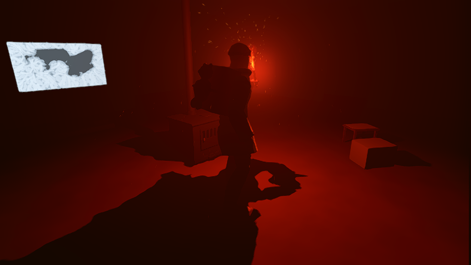
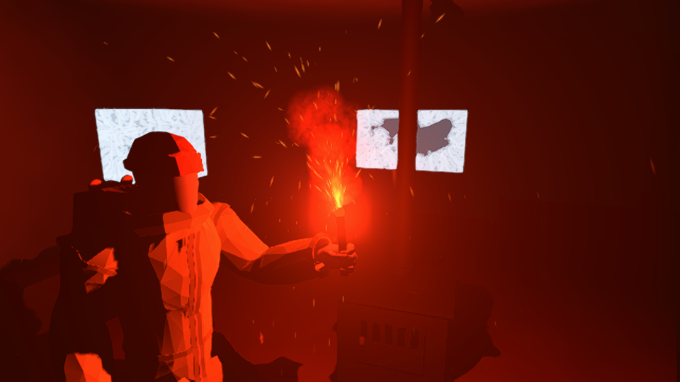
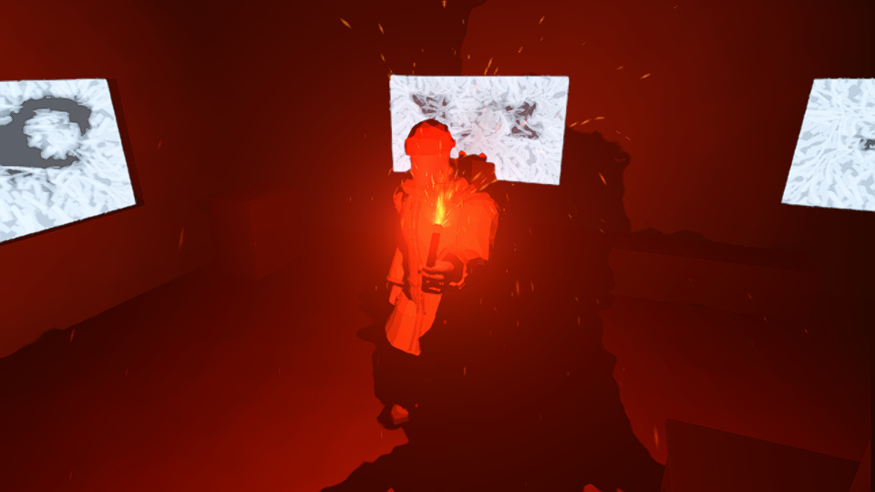
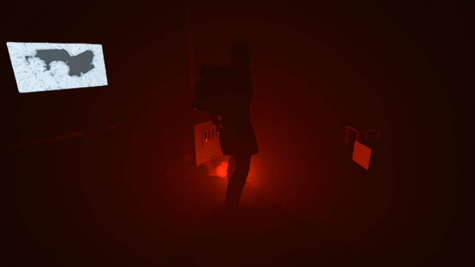

# Road flare: shadows and restrained scattering

Real 727 night captures, 2026-10-29. Godot 4.8-dev6 mono (`8898c2b3d`),
Forward+/Vulkan, llvmpipe LLVM 19.1.7. All PNGs are 960×540.

Stage 1 enables dynamic shadows. Stage 2 adds a neutral, non-emissive FogVolume
at the same burning tip: density 0.018, diameter 1.6 m, edge fade 1.0. Direct
colour, energy, radius, global fog and NPR material shaders are unchanged.
`HotCore` does not cast shadows around its enclosed light; the flare body does.
Bias/normal bias are exposed at 0.03/0.3. Set `scattering_density` to 0 to disable
only the added medium. The original light's `fog_energy` remains 0.3.

| View | Stage 1: shadows | Stage 2: shadows + scattering |
| --- | --- | --- |
| Room / floor |  |  |
| Hand / clothing |  |  |
| Wall silhouette |  |  |
| Dropped flare |  |  |

## Verification

- All eight PNGs were opened and visually inspected. Henry, backpack, furniture,
  wall and floor shadows remain legible; no obvious contact acne or detached
  shadows were visible at the captured hand/coat angles. This is a static-angle
  check, not coverage of every animation or GPU.
- The 39 visible character/equipment meshes all have shadow casting enabled.
  Decorative hot-core geometry is excluded. NPR lookup stylization is preserved.
- Every pair has identical cameras, player/light positions and light energy;
  the scene, pose, particles and burn are paused while the pair is rendered.
- The real `HeldLightComponent.drop()` preserves the same burning flare, its
  shadow-casting light and the FogVolume attached to the tip. Extinguishing
  hides both light and volume.
- The added scattering is deliberately slight. It lifts the air near the tip
  without erasing the floor/wall silhouette or adding an emissive sphere.
  The existing particle smoke and its warm puffs were not changed.
- Auxiliary cameras exclude reserved snow-contact/map layers and the
  player-camera screen pass. Default camera masks incorrectly exposed the
  snow-contact height encoder; those invalid preliminary captures are excluded.
- .NET build: zero warnings/errors. Existing `test_held_light.gd`: passed.
  Updated scripts import successfully; the corrected timing run has no script
  errors. Existing scene warnings about missing tangents/debug label paths remain.

## Performance

Same 727 camera, dropped flare, paused scene; a 3 mm oscillation of the light
forces dynamic shadow updates. Two orders: 0→1→2 and 2→1→0, eight warm-up frames
and 12 measured samples per state. No unshadowed PNG was saved.

| State | Forward-order median, ms/frame | Reverse-order median, ms/frame |
| --- | ---: | ---: |
| Shadows off, local volume hidden | 1210.4 | 1131.6 |
| Dynamic shadows, local volume hidden | 1583.8 | 1458.8 |
| Dynamic shadows + local volume | 1459.7 | 1430.6 |

Shadows cost approximately **29–31%** in this software-rendered scene. The added
volume's cost cannot be separated reliably from run/order variation; its lower
numbers do not establish an optimization. GPU-device timestamps and all samples
are in `performance_report.json`. A synchronization sample can span the prior
frame, so assess the medians, not the raw p95/max, as steady-state estimates.
These are llvmpipe measurements, not target-GPU frame rates. Target hardware
and moving-camera/animation review are still required before a hardware budget
or broad artifact-free claim can be made.

`capture_report.json` records the eight image states and caster audit;
`verification.json` records pair equality, PNG hashes and visual inspection.
The PNG run completed before a timing-array typing fix; the corrected timing-only
launch is recorded separately in `performance_report.json`. Lighting and image
camera configuration were unchanged between those launches.

Reproduce with the existing harness (no new CI workflow):

```sh
xvfb-run -a "$GODOT_BIN" --path . --rendering-method forward_plus \
  --rendering-driver vulkan --audio-driver Dummy --fixed-fps 30 \
  --script res://tools/runtime/capture_flare_night.gd -- /absolute/output scattering
```

Use `shadows` for stage-1 PNGs only, or `benchmark` for timings without PNGs.
