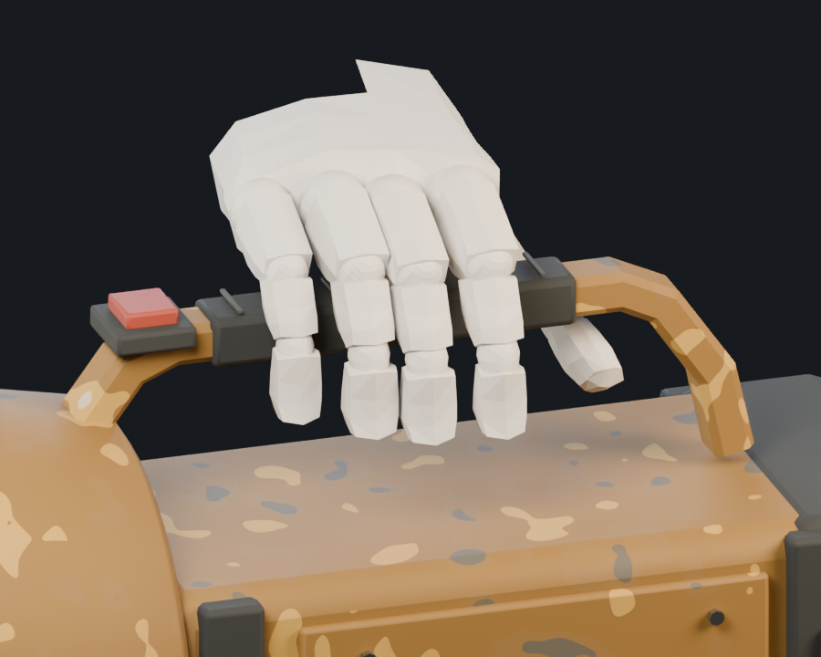

# Northbeam — geometry review v2

**Awaiting owner approval. Godot integration is paused.**
Real Blender 5.2.0 Cycles renders, light switched off; no emitted beam or animation.

| Front | Side |
| --- | --- |
|  |  |




The rejected model is preserved in
`assets/items/searchlight/source/intermediate_v1/`, with its earlier renders in
`../intermediate_v1/`. The new geometry remains under `source/candidate_v2/`;
it has not replaced the game GLB.

## Geometry

- Elongated battery housing; compact swept handle with thinner supports.
- Handle core: 22×16 mm; rubber grip: 26×20 mm; clearance above the case: 66 mm.
- Recessed clear, closed protective glass: diameter 189.6 mm. Actual parabolic
  reflector: 81 mm deep, with separate central LED, ceramic substrate and heatsink.
- Slim metal bezel and six small rubber pads, projecting 3.5 mm radially.
- 9,192 triangles, excluding the hand reference. Geometry QA passes: no
  degenerate faces, flipped islands, z-fighting or detached parts detected.
  The opposing glass/gasket contact faces are retained to keep the glass closed
  for refraction; that is the one explained QA warning.
- Material/wireframe outputs were visually inspected. This is an editable
  55-part, nine-material look-development source, not the final batched game asset.
  UV atlas consolidation, baking and game export follow approval.

## Actual Henry hand reference

`tools/blender/extract_searchlight_hand.py` copies the right hand from
`assets/characters/henry/henry_outfit.glb`, statically curls the existing finger
bones by 22°/45°/20°, bakes that pose into the copied mesh, then deletes the body,
left hand, rig and every other object. The standalone file contains exactly one
mesh, `HenryRightHandBare`, at the original scale. The original character asset
is unchanged.

The final static bare-hand placement has zero detected triangle intersections
with the grip, handle, case and switch (`hand_fit_check.json`). It is a size and
clearance guide, not a final gameplay hand pose. Winter-glove finger contact and
animated wrist behavior are not claimed validated at this review stage.

Source files:

- `assets/items/searchlight/source/candidate_v2/henry_right_hand.blend`
- `assets/items/searchlight/source/candidate_v2/searchlight_geometry_review.blend`
- `assets/items/searchlight/source/candidate_v2/searchlight_with_henry_hand.blend`

Reproduce with the separately installed EL4CTEO/blender-skills (Codex only):

```sh
blender -b --factory-startup --python-exit-code 1 \
  --python tools/blender/extract_searchlight_hand.py
blender -b --factory-startup --python-exit-code 1 \
  --python tools/blender/build_searchlight.py -- --skills /path/to/blender-skills
```
